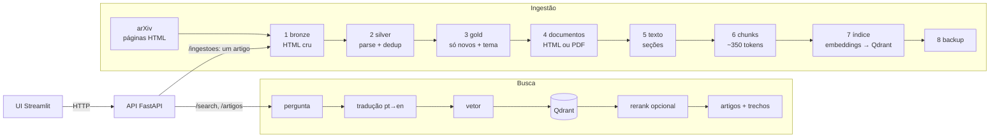

# vectordb-didatico

Versão didática de um pipeline de ingestão de artigos do arXiv com busca
semântica, originalmente montado com Docker (Prefect, RustFS, Iceberg,
GROBID, TEI, LibreTranslate, Qdrant). Aqui é o mesmo caminho, de artigo novo do arXiv até
busca semântica, em **Python puro**, sem Docker e **sem API para obter os
artigos**. Os artigos vêm das páginas HTML que qualquer pessoa abre no
navegador.

Cada etapa é um arquivo curto, numerado na ordem do desenho, e grava o
resultado em `data/` num formato que dá para abrir no editor (HTML, JSON,
JSONL). Dá para rodar uma etapa, olhar o que ela produziu e só então rodar a
próxima.

Há também uma **interface** (Streamlit) com duas abas: **Buscar**, que mostra
o que a busca recuperou (sem LLM), e **Inserir artigo**, que recebe um link
do arXiv ou um PDF e o indexa. Como no desenho de arquitetura, a interface só
fala com a API, por HTTP.

## Do desenho para o código



| No desenho (original) | Aqui | Arquivo |
|---|---|---|
| arXiv OAI-PMH | página `/list/<categoria>/new` e links `/abs/<id>` | `etapa1_bronze.py` |
| RustFS (S3), buckets `datalake-*` | pastas em `data/` | `config.py` |
| Iceberg + catálogo SQLite | arquivos JSONL, gravados de forma atômica | `util.py` |
| `load_bronze` | baixa e guarda o HTML como veio | `etapa1_bronze.py` |
| `load_silver` | parse do HTML e remoção de duplicatas | `etapa2_silver.py` |
| `load_gold` | só v1, ≤ 7 dias; tema RAG › Agents › LLM | `etapa3_gold.py` |
| `load_documents` | baixa o HTML do artigo (ou o PDF) | `etapa4_documentos.py` |
| `load_text` com GROBID | HTML do LaTeXML com BeautifulSoup; PDF com PyMuPDF | `etapa5_texto.py` |
| `load_chunks` | mesma estratégia, simplificada | `etapa6_chunks.py` |
| `load_embeddings` + TEI + Qdrant | fastembed (ONNX, CPU) + Qdrant em modo local | `etapa7_indice.py` |
| backup no `datalake-backup` | zip em `data/backup/`, guarda os 7 últimos | `backup.py` |
| Prefect (agenda, UI) | um laço que chama as etapas; agendamento pelo cron | `pipeline.py` |
| LibreTranslate | modelo Argos pt→en via ctranslate2 | `traducao.py` |
| TEI reranker | cross-encoder do fastembed | `busca.py` |
| `retrieve` + API FastAPI | igual, mais enxuto; e endpoints de inserção | `busca.py`, `api.py` |
| UI de teste (Streamlit + Ollama) | só recuperação, sem LLM; aba de inserção | `ui/app.py` |
| — | inserção de um artigo pela API, em fila | `ingestao.py` |

As **regras de negócio são as mesmas**: classificação de tema, janela de 7
dias, chunk 0 = abstract, cabeçalho "Title / Section" no texto que vira
vetor, `UUID5(chunk_id)` como id do ponto, uma collection por tema e busca
agrupada por artigo. O que mudou foi a infraestrutura.

## Rodando

Precisa do [uv](https://docs.astral.sh/uv/) e de Python 3.12.

```bash
uv sync

# Identifique-se para o arXiv: os termos de uso pedem um contato no User-Agent
export DIDATICO_USER_AGENT="vectordb-didatico/0.1 (mailto:voce@exemplo.com)"

# Primeira vez: uma categoria e só 5 documentos (~1 minuto, contando o
# download dos modelos)
uv run python -m didatico.pipeline --categorias cs.CL --limite 5

# Artigos específicos, por link (sem listagem)
uv run python -m didatico.pipeline --links https://arxiv.org/abs/2609.28614 2609.28653

# Tudo das categorias padrão (cs.CL, cs.AI, cs.LG); ~3 s por documento
uv run python -m didatico.pipeline
```

Buscar:

```bash
uv run python -m didatico.busca "memória de longo prazo para agentes"
uv run python -m didatico.busca "reward hacking" --tema agents -k 3 --rerank
uv run python -m didatico.busca "LoRA rank allocation" --json
uv run python -m didatico.busca "memória de longo prazo para agentes" --sem-traducao
```

API e interface, cada uma num terminal:

```bash
uv run uvicorn didatico.api:app --port 8000     # http://localhost:8000/docs
uv run streamlit run ui/app.py                  # http://localhost:8501
```

No modo local, só a API abre o índice. Insira artigos pela interface, ou
pare a API antes de rodar o pipeline pela linha de comando. Em contêiner
não há essa restrição (veja abaixo).

| Endpoint | O que faz |
|---|---|
| `GET /search?pergunta=...&tema=rag&k=5&trechos_por_artigo=2&rerank=true&traduzir=true` | busca; resultado por artigo, com os trechos |
| `GET /artigos/{id}?secao=result&max_trechos=8` | trechos do artigo, na ordem do texto |
| `GET /artigos/{id}/documento` | o HTML/PDF guardado (é o link de um PDF enviado) |
| `POST /ingestoes/link` `{"link": "...", "tema": null}` | insere um artigo do arXiv; responde na hora com o id da tarefa |
| `POST /ingestoes/pdf` (multipart: `arquivo`, `titulo`, `tema`) | insere um PDF |
| `GET /ingestoes/{id}` · `GET /ingestoes` | andamento: `na_fila` → `rodando` (com a etapa) → `concluida` / `falhou` |
| `GET /health` | status, trechos por tema, inserções na fila |

Cada etapa também roda sozinha, por exemplo
`uv run python -m didatico.etapa2_silver`. Testes: `uv run pytest`.

## Rodando em contêiner

Só precisa do Docker. Uma imagem serve para pipeline, busca e API; a
interface tem a sua, só com o Streamlit. O `docker-compose.yml` acrescenta o
Qdrant como **servidor**. Com ele, a API
continua no ar enquanto o pipeline indexa, o que o modo local não permite.
O código é o mesmo: com `QDRANT_URL` definido, `abrir_qdrant()` usa
`url=` em vez de `path=`.

```bash
# opcional: contato para o User-Agent do arXiv
echo 'DIDATICO_USER_AGENT=vectordb-didatico/0.1 (mailto:voce@exemplo.com)' > .env

docker compose up -d --build        # Qdrant + API + UI
# UI:  http://localhost:8501
# API: http://localhost:8100/docs

# pipeline e busca rodam sob demanda; as opções são as mesmas de cima
docker compose run --rm pipeline --categorias cs.CL --limite 5
docker compose run --rm pipeline --links https://arxiv.org/abs/2609.28614
docker compose run --rm busca "memória de longo prazo para agentes" --rerank

docker compose down                 # para tudo (o índice fica no volume qdrant_data)
```

- `./data` é montado no contêiner, então as camadas ficam visíveis no host,
  como fora do Docker. O contêiner roda com o seu UID (`UID`/`GID`,
  padrão 1000), e os arquivos ficam com você como dono, não com o root.
- Os modelos (~230 MB) não vão na imagem. São baixados na primeira execução
  para o volume `modelos` e reaproveitados depois.
- O painel do Qdrant fica em http://localhost:6433/dashboard.
- O backup inclui um snapshot de cada collection, gerado pelo próprio Qdrant
  (`qdrant_snapshots/<tema>.snapshot` dentro do zip).
- O estado do índice é separado por destino (`indice_estado.json` para o
  modo local, `indice_estado_servidor.json` para o servidor). Se o volume do
  Qdrant for apagado (`docker compose down -v`), o pipeline percebe o índice
  vazio e reindexa tudo.

## O que cada etapa grava

```
data/
├── bronze/
│   ├── listas/2026-11-02/cs.CL.html     listagem do dia, como veio
│   ├── artigos/2609.28614.html          página /abs de um link
│   ├── uploads/<id>.pdf + <id>.json     PDF enviado pela UI e o que foi digitado
│   ├── temas_manuais.json               tema escolhido na inserção
│   └── manifesto.jsonl                  url, sha256 e horário de cada arquivo
├── silver/artigos.jsonl                 um artigo por linha, sem duplicatas
├── gold/artigos.jsonl                   só os de interesse, com tema e evidência
├── documents/<tema>/
│   ├── 2609.28614.html                  texto completo (ou .pdf)
│   └── 2609.28614.secoes.json           parágrafos com a seção de cada um
├── chunks/2609.28614.jsonl              trechos prontos para o embedding
├── qdrant/                              índice vetorial (modo local)
├── indice_estado.json                   hash dos chunks já indexados
└── backup/2026-11-02_211935.zip
modelos/                                 embedding, reranker e tradutor (baixados uma vez)
```

Rodar de novo é seguro: cada etapa pula o que já fez. Uma listagem do mesmo
dia não é baixada outra vez, e um documento já baixado não é pedido de novo.
Um artigo cujos chunks não mudaram não é reindexado.

## Inserir um artigo

Pela aba **Inserir artigo** (ou direto na API), um link do arXiv ou um PDF
passa pelas mesmas etapas do pipeline, restritas àquele artigo. Leva de 1 s
(PDF) a uns 15 s (link, pelo intervalo de 3 s entre requisições ao arXiv).

- **Fila.** A API responde na hora com o id da tarefa e uma thread processa
  uma inserção por vez. A interface pergunta o andamento a cada segundo e
  mostra a etapa. O histórico de tarefas fica só na memória: reiniciar a API
  o esquece, mas os artigos indexados continuam no índice.
- **PDF enviado.** O título vem do formulário ou da maior fonte da 1ª página,
  e o abstract é o texto entre "Abstract" e a introdução. Se o PDF tiver o
  carimbo do arXiv na margem (`arXiv:2610.40927v1`), o artigo ganha esse id
  e não duplica o que já veio pela listagem. Senão, recebe `local-<hash>`, e
  o mesmo arquivo enviado de novo cai no mesmo id.
- **Tema.** Por padrão vale a regra da gold. Um artigo sem as palavras-chave
  fica de fora, e a mensagem diz isso. Escolher o tema na inserção o inclui
  mesmo assim, e a escolha fica registrada em `bronze/temas_manuais.json`.
- **Pedido explícito entra mesmo antigo.** A janela de 7 dias vale para a
  listagem, não para o que alguém pediu.
- **Um escritor por vez.** O pipeline pela linha de comando e as inserções
  reescrevem os mesmos arquivos. Uma trava de arquivo (`flock` em
  `data/.trava_escrita`) faz um esperar o outro, mesmo em processos ou
  contêineres diferentes.

## Escolhas didáticas, e o preço de cada uma

- **HTML em vez de API.** A listagem `/list/<cat>/new` traz o abstract e
  separa *New*, *Cross* e *Replacement*. É isso que permite saber se o
  artigo é novo sem consultar versões. A data da v1 de um artigo listado é a
  data do anúncio. O preço: se o arXiv mudar o layout da página, o parse da
  etapa 2 quebra. Como o bronze guarda o HTML cru, basta corrigir o parse e
  rodar de novo, sem baixar nada.
- **HTML do artigo em vez do GROBID.** O arXiv gera HTML da maioria dos
  artigos (LaTeXML), com seções, apêndices e bibliografia já marcados. Quando
  não há HTML (cerca de 5% numa listagem de teste), o PDF passa pelo PyMuPDF
  com uma heurística de títulos numerados. Ela acerta as seções em artigos
  LaTeX comuns, mas deixa entrar texto de figuras como parágrafo.
- **JSONL em vez de Iceberg.** É legível e simples. Não há time travel nem
  partições, e a silver é refeita inteira a cada execução, o que é barato
  nesse volume.
- **Qdrant em modo local.** É a mesma API do servidor
  (`QdrantClient(path=...)` em vez de `url=...`). Só um processo pode abrir
  a pasta por vez, então não rode a API e o pipeline ao mesmo tempo. Dentro
  da API, busca e inserção se revezam numa trava, e a busca espera alguns
  segundos se cair durante a indexação de um artigo.
- **Tradução.** O `argostranslate` puxaria o PyTorch. Aqui o mesmo modelo
  roda direto no ctranslate2 (motor) com o sentencepiece (subpalavras),
  cerca de 50 ms por pergunta em CPU. O idioma é detectado por contagem de
  palavras típicas, o que basta para perguntas curtas. Na dúvida, a
  pergunta fica em inglês.

## Para explorar

- Busque a mesma pergunta em português com e sem `--sem-traducao` e
  compare os resultados.
- Mude `ALVO_TOKENS` em `config.py`, apague `data/chunks/` e
  `data/indice_estado.json` e rode `etapa6_chunks` e `etapa7_indice`. Os
  trechos maiores ajudam ou atrapalham?
- Compare `--rerank` com a busca sem rerank na mesma pergunta. Na
  interface, ligue "Comparar com e sem reranking".
- Insira pela interface um PDF que não fale de RAG, agentes nem LLM. Veja a
  recusa, insira de novo escolhendo o tema e encontre o artigo na busca.
- Abra `data/gold/artigos.jsonl` e confira o campo `evidencia`. Algum artigo
  caiu no tema errado? A regra está em `etapa3_gold.classificar_tema`.
